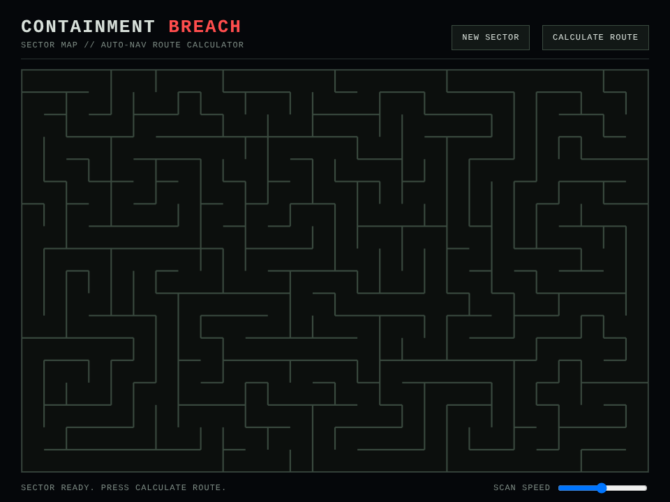
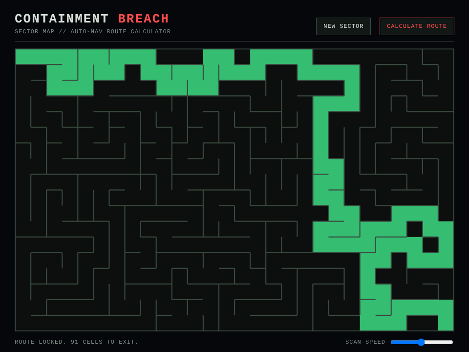

# containment-breach

I wanted to actually *see* a maze algorithm work instead of reading about
it, so I built one that carves a maze with recursive backtracking, solves
it with A*, and draws every step of both to a canvas. Then I dressed it
up as a collapsing facility sector, because watching something "escape" a
breach is more fun to me than watching a solver crawl across graph paper.

A freshly carved sector, then the A* solver's exit route locked in:





## How I built it

I split it into three plain modules plus a bit of glue, so each piece does
one job and I can reason about them separately.

### Generating the maze

For the generation I used recursive backtracking. I start at the top-left
cell, pick a random unvisited neighbour, knock down the wall between them,
and keep going until I hit a dead end, then I back up the stack and carry
on from the last cell that still had options. When the stack empties, every
cell has been visited and I have a perfect maze (exactly one path between
any two cells).

The thing I cared about most here was being able to animate it, and that
turned out to be the tricky part: the algorithm finishes almost instantly,
so there is nothing to watch if I just draw the result. My fix was to have
the generator record every wall it opens as it goes, in order, instead of
only returning the finished grid:

```js
steps.push({
  from: { row: current.row, col: current.col, dir: chosen.dir },
  to: { row: next.row, col: next.col, dir: chosen.opposite }
});
```

Then the front end replays that `steps` list a few at a time on a timer, so
the carving animates cleanly even though the real work already happened in a
blink. I liked this better than trying to pause the algorithm mid-run, the
logic stays simple and the animation is just playback.

### Solving it

For solving I went with A*, running from the top-left cell to the
bottom-right. I used the Manhattan distance as the heuristic, which works
well here because the goal is always the far corner, so the search leans
toward it instead of flooding outward evenly. My solver returns two things:
the order cells were visited in, and the final path. I wanted both so I
could animate the search itself (the cells A* considers) before drawing the
exit route on top.

### Rendering it

The renderer just draws walls as lines and fills individual cells for the
highlights. During the solve I wash the visited cells in amber so you can
watch A* sweep toward the corner, then I paint the final path green once it
locks on. Keeping the renderer dumb (it only knows how to draw walls and
fill cells) meant all the interesting logic stayed in the maze and solver
modules.

## Running it

It is a static page with no build step.

```
npx serve .
```

Open the printed URL. The sector carves itself on load. I added a "NEW
SECTOR" button for a fresh layout and "CALCULATE ROUTE" to run the search
and watch it resolve.

## What's in here

- `maze.js`: my recursive-backtracking generator, returns the grid plus the
  ordered carving steps
- `solver.js`: my A* solver, returns the visit order and the final path
- `renderer.js`: canvas drawing for walls and cell highlights
- `app.js`: wires the buttons up and runs both animations on a timer

## Credit

I looked at gtigas/maze-viz for the idea of visualising maze algorithms
step by step rather than drawing the finished maze all at once. My
generation algorithm, animation approach, and rendering are my own, but
that project is what got me thinking about showing the process instead of
just the result.

## Notes

No dependencies and no build tool. Everything runs from plain script tags,
which is exactly how I wanted it for something this small.
